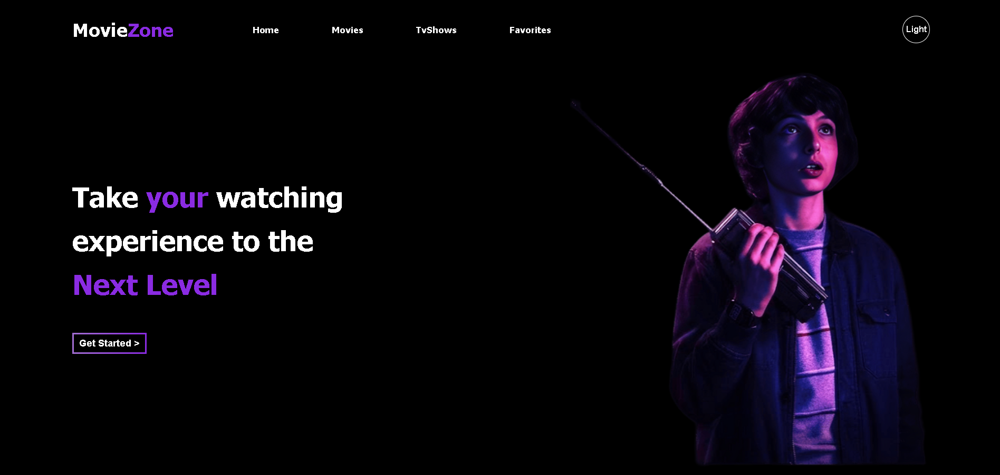
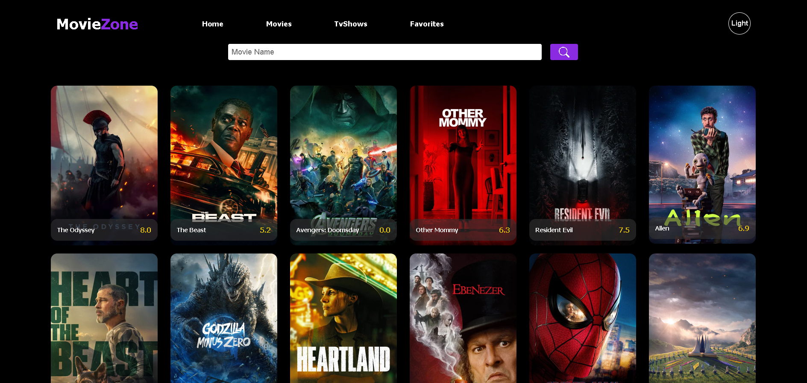
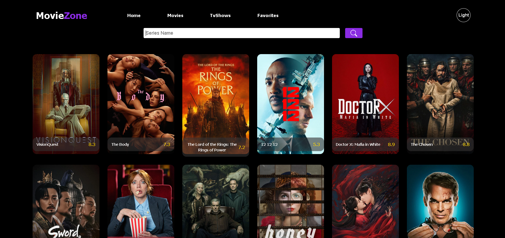
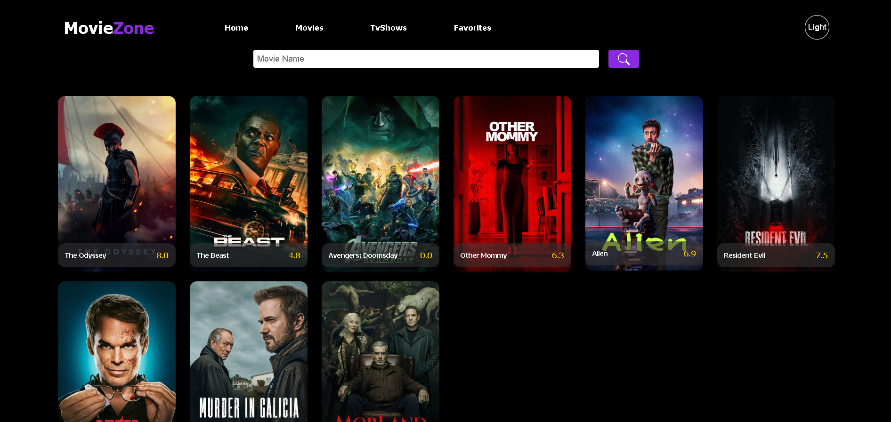

# 🎬 Movie Explorer

A modern and responsive web application for discovering movies and TV shows.

Movie Explorer allows users to explore trending content, search for movies and TV shows, and manage their personal favorites through a clean and user-friendly interface.

---

## 🌐 Live Demo

**[Movie-Zone](https://abdelwahab-mh.github.io/Movie-Explorer/)**

---

## 📸 Screenshots

### 🏠 Home Page


### 🎥 Movies


### 📺 TV Shows


### ❤️ Favorites


---

## ✨ Features

- Browse trending movies and TV shows.
- Search for movies and TV shows.
- Add and remove items from favorites.
- Save favorites using LocalStorage.
- Responsive design for different screen sizes.
- Dynamic content loading using TMDB API.

---

## 🛠️ Technologies Used

- HTML5
- CSS3
- JavaScript (ES6+)
- TMDB API
- LocalStorage
- Git & GitHub

---

## ⚙️ Getting Started

1. Clone this repository:

   ```bash
   git clone YOUR_GITHUB_REPOSITORY_URL
   ```

2. Open the project folder.
3. Configure your TMDB API key.
4. Open `index.html` in your browser.

---

## 🎬 API

Movie and TV show data are provided by [The Movie Database (TMDB)](https://www.themoviedb.org/).

This product uses the TMDB API but is not endorsed or certified by TMDB.

---

## 👨‍💻 Developer

Developed as a personal Front-End development project to practice JavaScript, API integration, and responsive web design.
